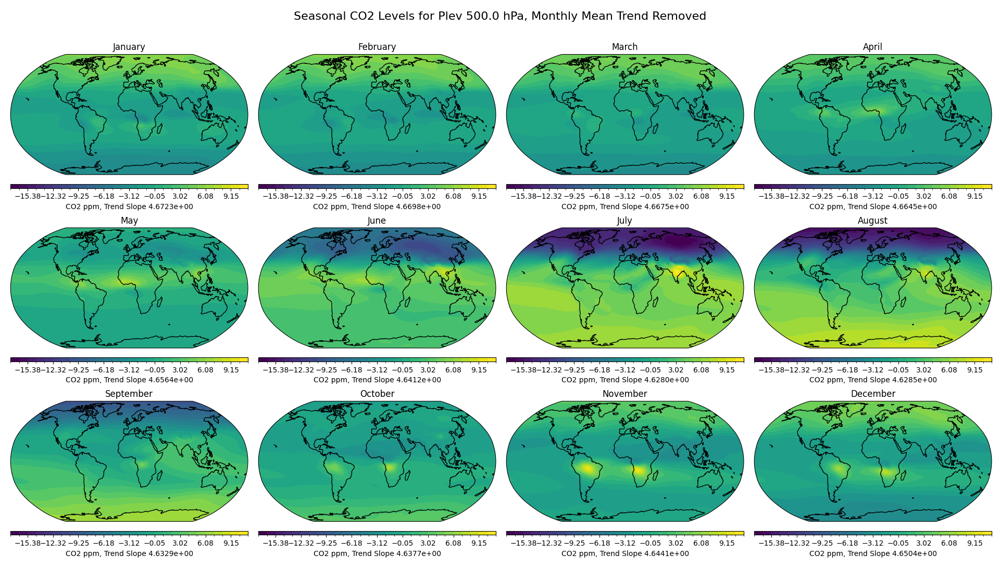
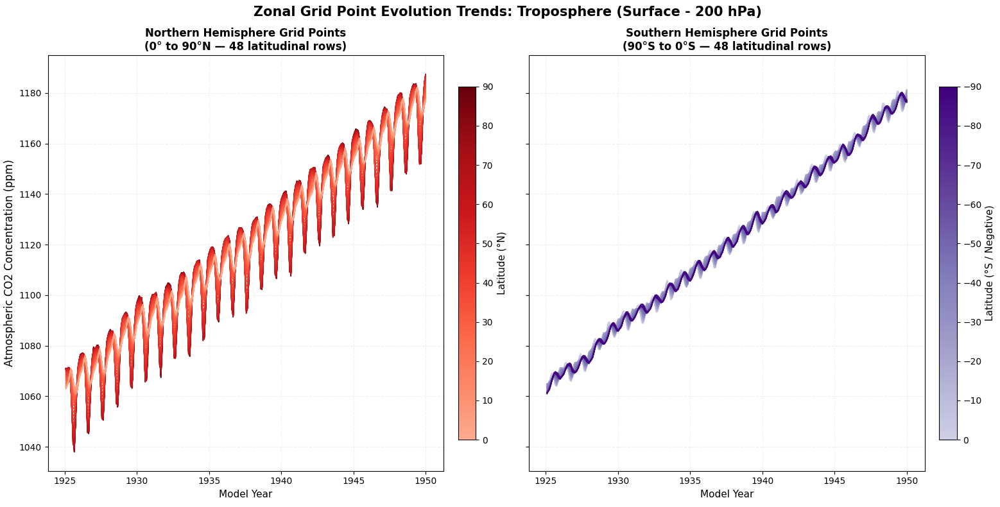
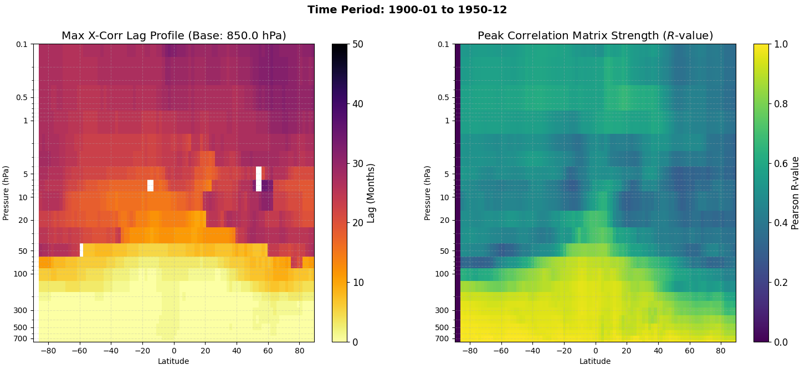
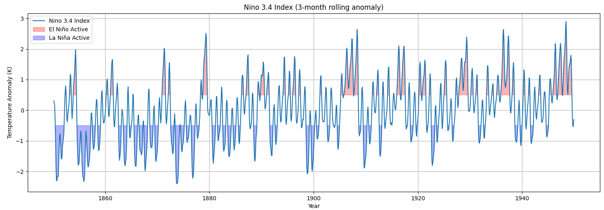
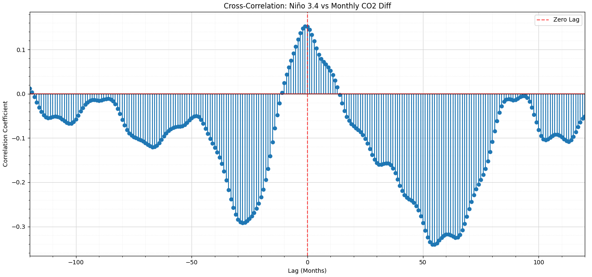
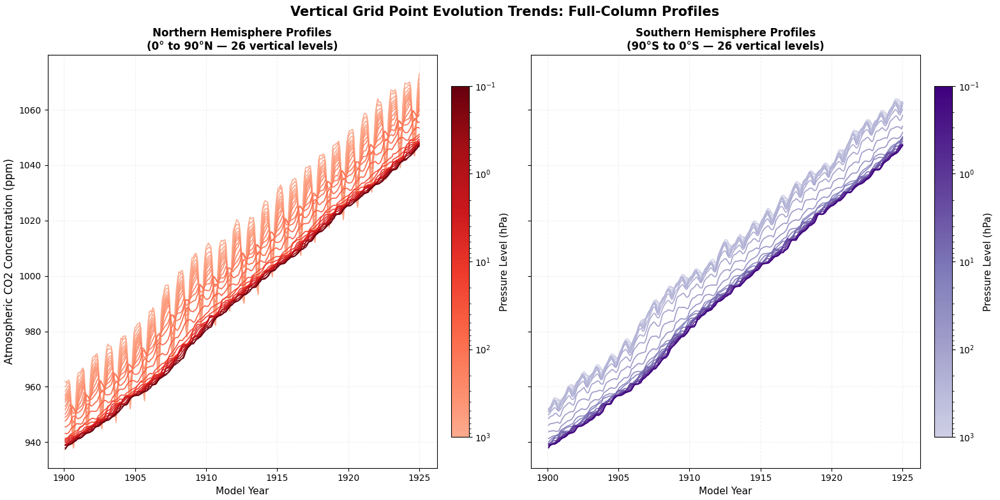

# Atmospheric CO2 Analysis

### Welcome to my HIWI (research assistant) Project
The code in this repository was written while I was working for GEOMAR in Summer 2026. It was part of a project to analyze model data to learn more about the patterns of CO2 in the atmosphere. A selection of scripts and functions have been highlighted below in this ReadME. All scripts are free to use for non-commercial purposes.

### Use of AI
AI was used in the creation and review of several functions in this repository. I primarily used Google's AI (which is Gemini under the hood). The code itself has been proofread and checked to make sure it does what it is supposed to do - the comments have not been as closely reviewed and are mostly AI generated.  

### File Structure and Format
This is essentially a library of scripts. With the exception of a few shared functions and variables in `helpers.py`, all files are independant. Requirements for the python/pip virtual env can be found in requirements.txt.

Each file follows the traditional format of a python script. All variables and inputs to the functions can be manually input at the code block at the bottom. There is also a `--zec` flag available on several files that redirectes to a different data file. Global file paths can be updated in `helpers.py`. Some scripts from earlier in the project require the file path to a directory of yearly files as an input. 

There is one jupyter notebook file that I used to break down the structure of my data when I recieved it. As I cannot upload the data with this project, I am leaving it so there is a reference for how the data was structured. This file does not need to be run - no other files depend on it. It has also been added as a pdf in case you don't want to open/run jupyter notebook. 

## Sample of Functions and Graphs

`map_seasonal_cycle.py` -> `map_cycle`

`co2_trop_vs_strat.py` -> `plot_co2_zonal_grid_trend`

`lag_correlation_2.py` -> `ccf_table`

`related_phenomena.py` -> `enso_index`

`relative_increase.py` -> `monthly_difference`

`co2_trop_vs_strat.py` -> `plot_co2_vertical_grid_trend`

